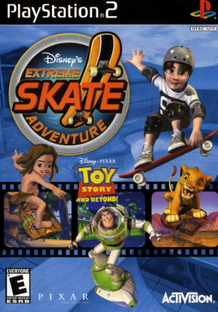

# Disney's Extreme Skate Adventure — versão para Windows



> **Estado: em desenvolvimento — atualizado em 27/11/2026.**
> Nos testes locais, o projeto já abre o menu, permite escolher personagem e chega ao HUB e a uma fase de Toy Story. Ainda não é um port completo: algumas fases podem travar, o carregamento pode demorar e vários recursos ainda precisam de validação.

## O que é este projeto?

É um projeto não oficial da comunidade para transformar o código de **Disney's Extreme Skate Adventure**, de PlayStation 2, em um programa para **Windows x64**.

Não é um emulador como o PCSX2: o código do jogo é convertido antecipadamente para C++ e os serviços do console são adaptados para o PC. O projeto ainda depende de uma cópia legal da versão americana do jogo.

**O repositório-fonte não inclui o executável pronto, o programa principal que executa o jogo nem os dados do jogo.** O pacote Windows é gerado por `scripts\Empacotar-Instalador.ps1` e pode ser baixado na página [Releases](https://github.com/vitoralvesdev/recomp-ps2-pc-disneys-extreme-skate-adventure/releases) quando houver uma publicação assinada. Até lá, o pacote local só deve ser distribuído pelo responsável após validar instalação e início do jogo.

## Progresso da recompilação

Atualizado em **27/11/2026**. O percentual só é usado quando existe um denominador conhecido; **não mensurável** não significa 0%.

| Componente | Progresso | O que já está feito | O que ainda impede 100% |
| --- | --- | --- | --- |
| **EE (R5900)** | **100% da exportação rastreada** | 9.390 funções no escopo Ghidra, incluindo 55 stubs de runtime; 41.864 handlers únicos na tabela AOT; nenhuma entrada ignorada na exportação. Metadados em [recomp/ghidra.toml](recomp/ghidra.toml). | Validar e corrigir os caminhos executados, tratar os stubs e tornar o build AOT reproduzível sem os arquivos locais. |
| **VU0** | **Não mensurável globalmente** | 1 imagem registrada (`A71F9755…`) e 27 blocos rápidos gerados. O caminho EE `0x109f48 → VU0 0x7e8` passou na regressão offline do wrapper e do runtime com 10 casos, incluindo chão, rampa, erros, limites e winding invertido. A integração offline também cobre a broadphase BSP, os laços EE `0x10c228`/`0x10c908`, faces pequenas e grandes, callbacks originais e retomadas cooperativas com dois objetos reais de `ToyStory_Bedroom`. | Inventariar as demais imagens e validar colisão, rampas e objetos durante o jogo. |
| **VU1** | **Não mensurável globalmente** | 1 imagem registrada (`87BD03B7…`) e 254 blocos rápidos gerados, usados pelo runtime AOT. | Cobrir as variantes de microprograma e validar os jobs em todas as fases e telas. |
| **VIF0 / VIF1** | **Parcial, sem percentual** | Parser de comandos, DMA direto/em chain e regressões de endereço inválido e END vazio. | Medir cobertura de todos os opcodes/caminhos e validar o fluxo gráfico de ponta a ponta. |
| **GIF / GS** | **Parcial, sem percentual** | Backend OpenGL 3.3, worker GPU e testes sintéticos de contrato GPU e de pacotes GIF. | Comprovar equivalência visual completa, transparência, profundidade e frames em todas as fases. |
| **Jogo completo** | **Em validação** | Menu, seleção de personagem, HUB, entrada em uma fase de Toy Story e gameplay inicial registrados localmente. | Validar todas as fases, personagens, ações, saves, áudio, vídeo, colisão, carregamento e instalação reproduzível. |

Os totais de geração foram conferidos no ambiente local. `src/generated-*` e `native/original/vu/generated/` não são versionados; por isso, um clone limpo ainda não reproduz o runtime AOT completo, conforme [docs/BUILDING.md](docs/BUILDING.md). O marco de **100% do EE** acima é de exportação/geração, não de fidelidade nem de conclusão do port.

### Evolução de FPS registrada

| Data | Cenário | Resultado | Comparação ou limite |
| --- | --- | ---: | --- |
| 06/11/2026 | HUB, frame 10500 | **21,69 FPS** após otimização do GS | 17,06 FPS antes, na mesma cena |
| 06/11/2026 | HUB, perfil de 10.500 frames | **18,3–27,2 FPS** no gameplay | Menu entre 59 e 60 FPS |
| 23/11/2026 | `ToyStory_Bedroom`, frames 8400–10500 | **59,98 FPS** (59,82–60,14) | 8 amostras; VIF1 36,9%, VU1 26,2% e GIF/GS 9,4% de ocupação |

A medição de 23/11 está documentada no histórico do projeto, mas sua captura bruta de FPS não foi localizada no ambiente atual. Ela não foi repetida agora e não deve ser tratada como um benchmark de todas as fases; os cenários de 06/11 e 23/11 também não formam uma comparação A/B. O port só poderá ser declarado **100% recompilado e validado** quando todos os itens da tabela estiverem concluídos e o fluxo completo do jogo for testado.

## O que já foi corrigido ou funciona nos testes locais

- **Menus e início do jogo:** menu, seleção de personagem, HUB e entrada em uma fase de Toy Story foram registrados em sessões locais.
- **Desempenho:** correções no VU0 melhoraram o fluxo de imagens. Em `ToyStory_Bedroom`, a média foi de **59,98 quadros por segundo (FPS)** em 8 amostras, perto do alvo de 60 FPS. Isso ainda precisa ser confirmado nas outras fases.
- **Carregamento de fases:** a instrumentação por etapa separou resolução e leitura de arquivo, `sceCdRead`, espera de streaming e descompressão. O log existente registrou leitura de 0–17 ms, enquanto uma amostra de 1 s concentrou cerca de 93% do tempo quente em `FUN_00270f58` (`0x270f58`), o descompressor LZSS de dicionário de 4 KiB usado pelos carregadores de arquivo. Ele foi substituído por código nativo equivalente, com retomada cooperativa a cada 1 KiB de saída. `DisneyNativeLoadDecompressTest` passou para literais, backreferences, wrap do dicionário, entrada vazia, retomadas cooperativas e os cinco handlers internos de retomada; a eliminação do hitch ainda precisa ser medida no jogo.
- **Launcher experimental:** o programa de instalação exige o `BOOT2` exato e o SHA-256 de referência do ELF americano `SLUS_206.07`, extrai os arquivos com progresso, compara extrações por hash, configura o jogo e mostra logs. O pacote recebe um manifesto SHA-256; a abertura usa uma checagem rápida dos componentes, sem recalcular todos os hashes, e `--verificar` mantém a auditoria integral. Depois de recompilar o runtime, `--atualizar-manifesto` regera o manifesto sem pedir a ISO novamente. **Configurações → Desinstalar jogo** remove dados e assets gerados após confirmação, preservando launcher, runtime, saves, configuração e logs; bloqueios transitórios de arquivos são repetidos por alguns segundos. A verificação manual de atualizações mostra carregamento e um modal quando não há versão nova.
- **Atualizações mais seguras:** o launcher só aceita HTTPS e deriva o nome do instalador da tag do release, conferindo a URL oficial e o tamanho anunciado pelo GitHub. Antes de executar, exige uma assinatura Authenticode confiável do Windows; a publicação do `Setup.exe` 0.5.0 ainda depende dessa assinatura.
- **Cartão de memória (memory card):** caminhos com drive, caminhos absolutos do Windows, caminhos que tentam sair da pasta (`..`) ou links externos agora são bloqueados. Leituras e escritas também verificam o intervalo inteiro de memória.
- **Controles:** teclado e controle têm mapeamento inicial, com posições baseadas em um controle tipo Xbox.
- **Gráficos e áudio:** menus e cenas são exibidos e testes básicos de textura passaram. Em 24/11/2026, o som inicial e o áudio da gameplay foram confirmados funcionando no jogo. A fidelidade visual e a cobertura integral do áudio ainda não estão validadas.
- **Build do launcher:** compila separadamente, sem ISO ou código gerado do jogo. Em 27/11/2026, o launcher foi reconstruído do zero em Release, o CTest do pacote passou 4/4 e o executável `DisneyLauncherTests` passou; em 26/11/2026, o CTest passou 1/1, incluindo os testes de desinstalação e preservação de saves, e a integração automatizada com ISO real foi ignorada porque `DISNEY_TEST_ISO` não estava definida. O ciclo real pela interface também foi concluído: a desinstalação removeu jogo, assets e intermediários, preservou os saves e manteve os hashes do runtime e do `config.ini`; a reinstalação restaurou o pacote. Após relinkar o runtime com a correção de colisão, o manifesto foi regenerado e `--verificar` conferiu 7.566 arquivos.
- **Áudio pela ISO:** o instalador não exige pacotes externos; converte VAGs/streams e recupera as músicas de `MUSIC.WAD` da própria imagem selecionada. Em 26/11/2026, após a desinstalação, a preparação no projeto real produziu **1.285 entradas** — 393 efeitos, 855 streams e 37 músicas — sem erros de conversão, arquivos ausentes ou músicas pendentes. A preparação nativa também foi repetida: o conversor COL v8 compilou sem erros e 272 colisões foram convertidas.
- **Vídeos da abertura:** os cinco `.PSS` iniciais contêm vídeo MPEG-2 e áudio SS2/PCM incorporado. O leitor foi validado offline em todos eles como PCM16 little-endian, 48 kHz e estéreo; a quantidade de áudio decodificada corresponde exatamente ao tamanho declarado em cada arquivo. O áudio agora é entregue continuamente ao backend Windows, e os frames são gravados no guest como macroblocos RGBA 16×16 column-major, com pixels row-major e stride de `0x400` bytes por bloco, conforme o consumidor original. O ELF contém caminhos genéricos `host`/`hdd` do motor, mas não há evidência de dependência de áudio externo nessa abertura. Em 24/11/2026, o áudio inicial foi confirmado funcionando no jogo; a apresentação visual e a mixagem completa ainda precisam de validação.
- **Auditoria de recursos:** os 26 `.PSS` nomeados no ELF têm correspondente extraído, e todos contêm o mesmo cabeçalho de áudio SS2. O diretório real da ISO não contém duas referências explícitas do ELF: `IOP/USBKB.IRX` e `IOP/DIAL_SPD.CNF`. As strings vizinhas de `USBKB.IRX` indicam teclado USB/debug; `DIAL_SPD.CNF` aparece em `dial=cdrom0:\IOP\DIAL_SPD.CNF;1`. Nenhuma das duas tem relação conhecida com a abertura, mas classificar seus fluxos como opcionais exige os XREFs no Ghidra.
- **Handlers originais copiados:** o runtime registra os blocos do kernel copiados para `0x80075000` e `0x80076000`, com aliases físicos/KSEG0 e retomada nos pontos internos. Os testes confirmam a tabela original de syscalls, o despacho dos handlers e a chamada aninhada `0x75158 → 0x3042ac`.
- **Falhas de runtime explícitas:** syscalls desconhecidos retornam erro e funções EE ausentes param por padrão; DMA GIF/VIF direto ou em chain com endereço inválido não sinaliza conclusão nem IRQ. Em 25/11/2026, registro, remoção e habilitação inválidos de IRQ, `Deci2Call` indisponível e `sceSifSetDChain` não implementado passaram a retornar erro explícito; OSD e descritores SIF DMA validam o intervalo guest completo. O build Release e o teste `runtime_flow` (1/1) passaram.
- **Dados de colisão:** o preparador converte os arquivos de colisão COL v8 das fases extraídas. Além do wrapper `0x109f48 → VU0 0x7e8`, a regressão offline cobre o carregador e a relocação BSP com dois objetos reais de `ToyStory_Bedroom` (faces pequenas e grandes), a broadphase, os callbacks originais `0x10c610`/`0x10c648`, os laços EE `0x10c228`/`0x10c908`, transformações e retomadas cooperativas. Foi corrigida a perda de candidatos quando outra consulta reutilizava o pool global `0x411268` enquanto a varredura estava suspensa: a broadphase agora é atômica entre checkpoints, captura os candidatos antes do próprio retorno e cada varredura mantém uma cópia privada até o retorno real. Os testes reproduzem a sobrescrita do pool tanto durante a retomada quanto na janela entre o retorno da broadphase e a leitura pelo caller, e exigem o acerto original. O fallback do único objeto real sem BSP não foi alterado porque sua alcançabilidade pelo caminho ativo não foi comprovada. Isso ainda não comprova que todas as rampas e objetos estejam corretos durante o jogo.

## O que ainda precisa melhorar

1. **Validação completa do jogo:** testar todas as fases, personagens, ações, salvamentos e telas do início ao fim.
2. **Carregamento:** o gargalo associado à espera de cerca de 15 segundos foi isolado no descompressor de assets, não na leitura ou sincronização de CD. A substituição nativa e os quatro testes registrados passaram, e o runtime foi recompilado; falta repetir a medição de entrada em uma fase no jogo para confirmar o tempo real.
3. **Desempenho nas demais fases:** repetir a mesma medição controlada no HUB e nas outras etapas.
4. **Colisão:** o pipeline offline agora cobre carregamento real, faces pequenas e grandes, broadphase, callbacks, transformações e isolamento dos candidatos durante retomadas cooperativas. Falta validar no jogo se todas as rampas e objetos de `ToyStory_Bedroom` respondem corretamente; o fallback do único objeto sem BSP permanece sem alteração até que sua alcançabilidade seja comprovada.
5. **Áudio:** o som inicial e o áudio da gameplay estão funcionando, mas ainda é necessário validar a mixagem em partidas completas. A varredura atual não encontrou WAVs vazios ou ausentes no catálogo, mas os logs ainda registram `couldn't load` para sons que existem no catálogo; a causa dessa divergência não foi isolada.
6. **Vídeos:** o demux PSS, os timestamps PES/DTS, o áudio incorporado e o layout de macroblocos foram corrigidos e validados offline. Em 24/11/2026, `runtime_flow`, `graphics_driver` e `DisneyLauncherTests` passaram, e o launcher verificou 7.573 arquivos do pacote; ainda é necessário confirmar os frames, a sincronização e o áudio das cutscenes no fluxo do jogo.
7. **Saves:** salvar e carregar uma partida completa ainda não foi testado do começo ao fim.
8. **Gráficos e controles:** revisar fidelidade, mistura de cores e transparências; testar mais modelos de controle.
9. **Runtime AOT distribuível:** o programa principal ainda não pode ser montado do zero em um clone limpo. O pacote Windows consome um artefato de runtime confiável, vinculado ao commit e com SHA-256; a geração completa do AOT continua dependente do ambiente local.
10. **Instalador assinado:** o `Setup.exe` local ainda não possui assinatura confiável. O atualizador reforçado só deve liberar downloads depois que um instalador assinado for publicado.
11. **Requisitos e direitos:** definir requisitos mínimos por testes em outros computadores e concluir a revisão dos direitos de redistribuição do runtime AOT. As procedências e licenças das DLLs e ferramentas de terceiros estão registradas em `docs/third-party-runtime/`.

## Como instalar e jogar

Você precisa de uma **cópia legal da versão americana de PlayStation 2 (NTSC-U)**. A instalação usa cerca de **2,3 GB** de espaço livre.

1. Baixe `DisneySkateSetup-0.5.0.exe` na página [Releases](https://github.com/vitoralvesdev/recomp-ps2-pc-disneys-extreme-skate-adventure/releases), quando houver uma publicação confiável e assinada.
2. Abra o instalador. Não é necessário instalar Python, .NET, CMake ou Visual Studio.
3. Abra `Disney's Extreme Skate Adventure.exe`, escolha a ISO americana e clique em **Instalar jogo**.
4. Quando o pacote estiver pronto, clique em **JOGAR**.

Como alternativa, extraia todo `DisneySkate-0.5.0-portable.zip` e abra o launcher dentro de `DisneySkate-0.5.0`. O marcador `launcher.portable` mantém os dados do jogo, os saves e os logs junto da extração. O ZIP portátil não recebe atualização automática; para trocar de versão, substitua o pacote manualmente preservando os dados do jogo, os saves e a configuração.

A extração é incremental e só pula arquivos cujo tamanho e SHA-256 coincidem com a ISO. O manifesto `package-manifest.sha256` cobre runtime, dados do jogo e assets, exclui saves e é regerado ao final da instalação. A ISO não é enviada para a internet.

Em 27/11/2026, o pacote 0.5.0 foi validado em pastas isoladas e sem Python, .NET, CMake ou Visual Studio no `PATH`: a variante de teste do instalador extraiu 107 arquivos, a instalação da ISO concluiu com código 0, converteu 272 colisões e 1.285 entradas de áudio, e `--verificar` conferiu 7.569 arquivos com código 0. O launcher abriu a tela pronta, iniciou o runtime por teclado, manteve a janela do jogo ativa por 12 segundos e foi encerrado com código 0; o ZIP portátil também foi extraído, auditado com 108 arquivos e reconhecido no modo portátil. O instalador oficial não pôde concluir a validação de registro e atalhos neste ambiente porque a escrita em `HKCU` é restrita; a variante `-TestInstall` remove somente esses dois pontos e não é um artefato de release. O pacote continua sem assinatura e sem Release publicado.

Alterações no launcher não exigem reinstalar a ISO. Depois de substituir o runtime ou os assets, execute `--atualizar-manifesto` para sincronizar o manifesto; a ISO só é necessária novamente ao instalar ou restaurar os dados extraídos. Em **Configurações → Desinstalar jogo**, o launcher remove os dados e os assets gerados após confirmação, mas preserva o launcher, o runtime, os saves, a configuração e os logs. No modo portátil, a pasta do jogo (incluindo `game\mc0` nesse layout) e `original\extracted\mc0` também são mantidas para não ocultar os saves. O cache do .NET e os temporários do fallback de desenvolvimento ficam em `analysis\preparation`, fora da área removida.

**Importante:** um clone limpo compila o launcher, mas ainda não monta sozinho o runtime AOT completo. O pacote de distribuição incorpora as ferramentas de preparação e consome um runtime confiável; a geração do AOT continua sendo uma etapa separada do ambiente de desenvolvimento.

Para diagnosticar o carregamento do runtime, execute-o com a variável de ambiente `PS2X_CD_LOAD_TRACE=1`; os logs `[cd-load]` separam resolução, leitura, `sceCdRead`, espera de streaming e descompressão.

## Controles

| Ação | Teclado |
| --- | --- |
| Direção | WASD ou setas |
| Confirmar / botão X | Espaço ou X |
| Voltar / círculo | C |
| Start | Enter |
| Select | Tab |
| L1 / R1 | Q / E |
| L2 / R2 | Shift esquerdo / Shift direito |

O jogo tenta usar o primeiro controle reconhecido. A compatibilidade varia conforme o modelo.

## Requisitos

- Windows x64.
- GPU e driver compatíveis com **OpenGL 3.3**.
- Cerca de **2,3 GB livres** para os dados extraídos.
- As DLLs necessárias do Microsoft Visual C++ acompanham o runtime; o launcher usa CRT estática.

Os requisitos mínimos de processador e memória ainda não foram medidos em diferentes computadores.

## Se algo não abrir

Atualize o driver da GPU pelo fabricante. Se faltar uma DLL do Microsoft Visual C++, instale o [Redistributable x64 mais recente](https://learn.microsoft.com/cpp/windows/latest-supported-vc-redist).

O launcher grava `analysis\launcher.log`, `analysis\game-session.log` e relatórios de travamento. Em uma instalação, os logs ficam em `%LOCALAPPDATA%\HighSky\DisneySkate\logs`.

Ao relatar um problema, informe a fase, o personagem, a ação e o resultado. **Nunca anexe ISO, WAD, saves ou outros dados originais do jogo.**

---

<details>
<summary><strong>Detalhes para quem compila ou colabora</strong></summary>

### Build isolado do launcher

```powershell
.\scripts\Compilar-Launcher.ps1
# ou:
cmake -S . -B build/launcher -G "Visual Studio 17 2022" -A x64 -DDISNEY_BUILD_LAUNCHER_ONLY=ON
cmake --build build/launcher --config Release --target DisneySkateLauncher DisneyLauncherTests --parallel 2
ctest --test-dir build/launcher -C Release --output-on-failure
```

O workflow Windows executa esse mesmo alvo e os testes. Veja [docs/launcher.md](docs/launcher.md).

### Comandos do launcher

| Comando | Efeito |
| --- | --- |
| `"Disney's Extreme Skate Adventure.exe" --verificar` | Audita componentes e hashes SHA-256; retorna 0 (válido) ou 2 (falha); não testa gameplay |
| `"Disney's Extreme Skate Adventure.exe" --atualizar-manifesto` | Regera o manifesto do pacote atual após uma recompilação do runtime |
| `"Disney's Extreme Skate Adventure.exe" --iso <imagem> --verificar` | Valida somente a ISO escolhida |
| `"Disney's Extreme Skate Adventure.exe" --instalar <imagem>` | Instala sem interface, útil para automação |
| `"Disney's Extreme Skate Adventure.exe" --diagnostico` | Sessão normal com relatórios em `analysis/hang-reports` |
| `"Disney's Extreme Skate Adventure.exe" --versao` | Mostra a versão do launcher |

### Runtime e instalador local

O runtime completo continua dependente de PS2Recomp, bibliotecas, dados do jogo e código recompilado gerado localmente:

```powershell
.\scripts\Compilar-Candidato-Original.ps1
```

Com o pacote pronto, também é possível abrir o runtime diretamente:

```bat
runtime\DisneySkateRuntime.exe original\extracted\SLUS_206.07
```

Com Visual Studio 2022 C++, CMake, .NET SDK 9 e Inno Setup 6, o script abaixo gera o pacote local:

```powershell
.\scripts\Empacotar-Instalador.ps1
```

O resultado fica em `dist\DisneySkateSetup-0.5.0.exe`, `dist\DisneySkate-0.5.0-portable.zip` e `dist\SHA256SUMS.txt`. O script compila launcher, COL8 autocontido e recuperador de música, incorpora Python 3.12.10 e Neversoft Multitool CLI v1.3.4 com hashes fixados, valida allowlist/PE x64/manifesto e só então gera os dois pacotes. Não inclui ISO, dados extraídos, áudio derivado, assets gerados, saves, logs, PDBs ou capas soltas; a capa do launcher é incorporada ao executável.

Para gerar um ZIP de runtime separado e consumi-lo no pacote:

```powershell
.\scripts\Empacotar-Runtime.ps1 -NoticesDirectory .\docs\third-party-runtime
.\scripts\Empacotar-Instalador.ps1 -RuntimeZip .\dist\DisneySkateRuntime-0.5.0.zip -RuntimeSha256 <hash-do-zip>
```

O workflow `.github/workflows/windows-release.yml` automatiza essa entrada por URL HTTPS e hash. Ele não publica por padrão. A publicação exige revisão dos direitos do AOT, certificado Authenticode e uma tag existente no commit em build. Veja [docs/DISTRIBUTION.md](docs/DISTRIBUTION.md).

### Medição de desempenho de 23/11/2026

| Métrica em ToyStory_Bedroom | Média de 8 amostras |
| --- | ---: |
| FPS lógico | 59,98 (59,82–60,14) |
| VIF1 | 36,9% |
| VU1 | 26,2% |
| GIF/GS | 9,4% |
| Worker GPU ocupado | 72,4% |
| Espera de GPU | 25,5% |

As amostras cobriram os frames 8400–10500. O log confirmou `Loading Scene ToyStory_Bedroom ...... done`, `CAREER_STARTED` e `starting a run`. A comparação controlada com o HUB e as demais fases ainda está pendente.

### Estrutura resumida

```text
src/host/          Runtime do host, memória, interrupções, áudio e vídeo
src/launcher/      Instalação, validação, interface, configurações e logs
native/original/   Gráficos, VIF/GIF, VU, IOP, áudio e entrada
native/            Conversor de assets e testes de colisão
tests/             Testes do runtime e dos drivers gráficos
scripts/           Preparação de dados, compilação e análise
recomp/            Configuração da recompilação
docs/              Documentação técnica e arquitetura
```

Veja [docs/BUILDING.md](docs/BUILDING.md), [docs/arquitetura-nativa.md](docs/arquitetura-nativa.md) e [docs/DISTRIBUTION.md](docs/DISTRIBUTION.md).

</details>

## Aviso legal

O jogo, seus personagens, marcas e a capa pertencem aos respectivos detentores de direitos. Este é um projeto não oficial, sem vínculo com eles. Não são distribuídos ISO, dados originais, saves ou binários prontos neste repositório.

O projeto contém componentes de terceiros com suas próprias licenças, incluindo GPL-3.0. A revisão final da proveniência e da licença global ainda está pendente.
